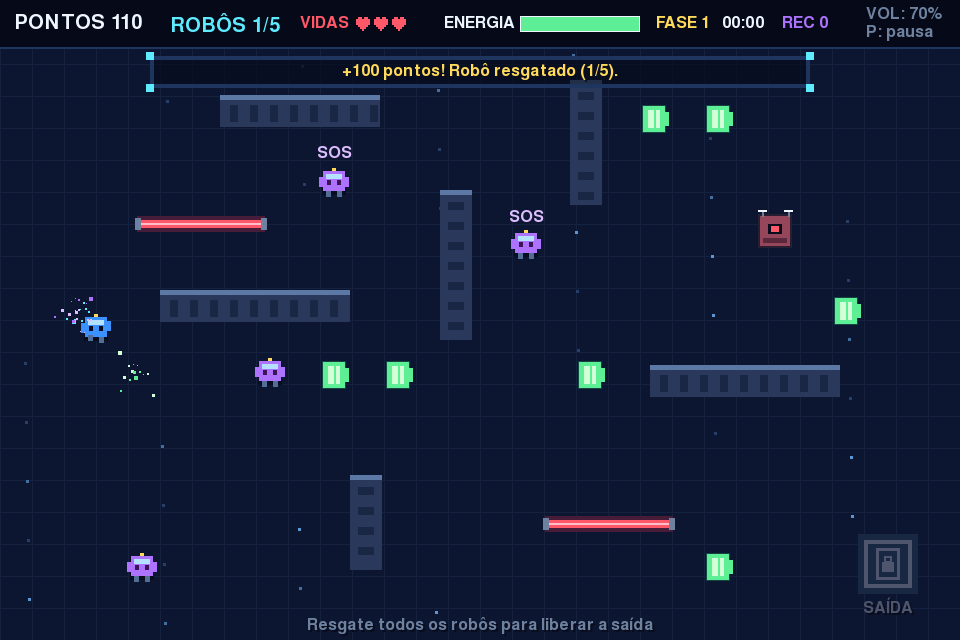
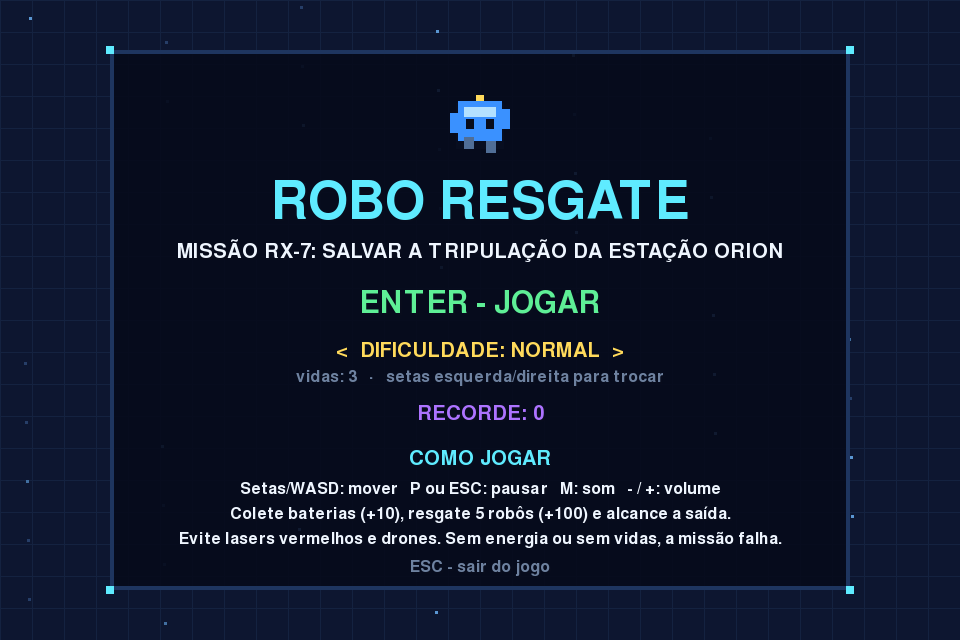
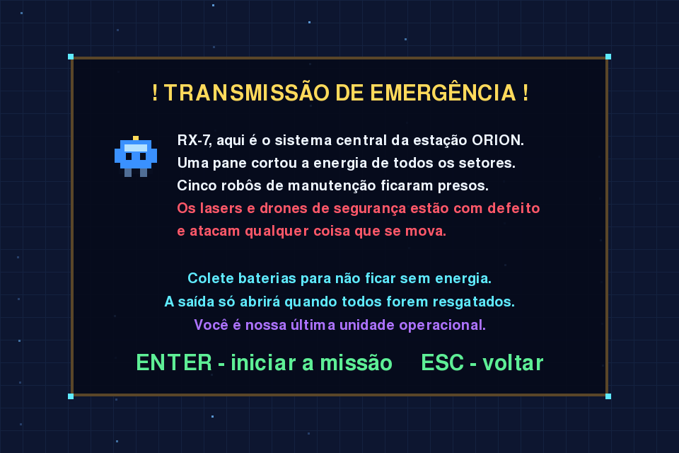
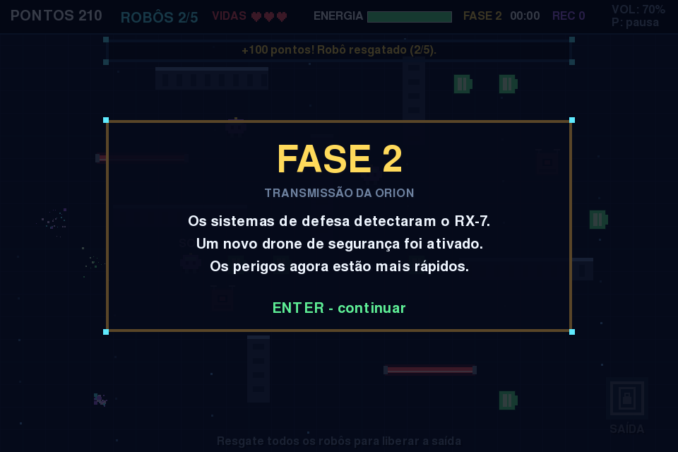
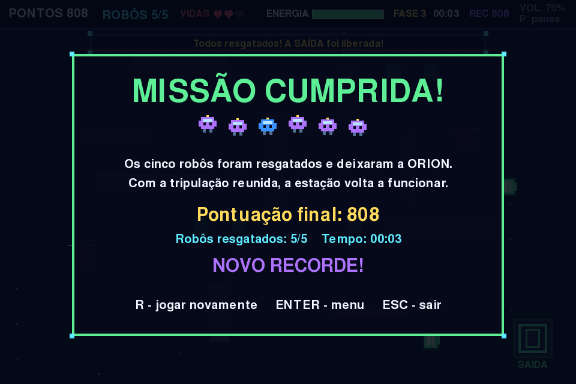
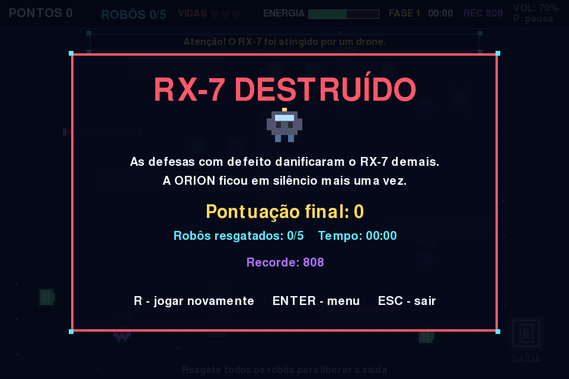

# Rescue Robot — A3 Desenvolvimento de um Jogo



## 1. Identificação

| Item | Informação |
|---|---|
| **Jogo** | Rescue Robot (na tela do jogo: "Robo Resgate") |
| **Disciplina** | Usabilidade, desenvolvimento web, mobile e jogos |
| **Professor** | Elzo Brito dos Santos Filho |

**Integrantes:**

| Nome completo | RA |
|---|---|
| Andrew Pedrosa Saraiva dos Santos | 82323912 |
| Gustavo de Oliveira Afonso do Amaral | 82320503 |
| Valéria Alves Silva | 82320665 |
| Vitor Moreira dos Santos | 823214219 |

## 2. Descrição e história

Rescue Robot é um jogo 2D de exploração e sobrevivência, em pixel art, que se passa numa estação espacial sem energia. O jogador controla o RX-7, um robô de manutenção que precisa resgatar cinco robôs presos, coletar baterias para não ficar sem energia e desviar de lasers e drones de segurança com defeito. A cada dois robôs resgatados a estação reage: novos perigos aparecem e tudo fica mais rápido.

- **Premissa:** o RX-7 é a última unidade operacional da estação ORION e recebe uma transmissão de emergência.
- **Conflito:** a estação está sem energia (a bateria do RX-7 cai o tempo todo) e as defesas com defeito atacam tudo o que se move.
- **Apresentação no jogo:** tela de introdução com a transmissão, textos de história a cada nova fase e mensagens durante a partida.
- **Desfechos:** três finais diferentes. *Missão cumprida* (todos resgatados), *Sem energia* (bateria esgotada) e *RX-7 destruído* (sem vidas).

## 3. Como executar

### Pré-requisitos
- Python 3.10 ou superior (testado com Python 3.13 e pygame-ce 2.5).
- pip.
- Windows, macOS ou Linux com ambiente gráfico.

### Instalação
Abra o terminal **dentro da pasta do projeto** e execute:

```bash
python -m pip install -r requirements.txt
```

### Executar
```bash
python main.py
```

No Windows, se `python` não funcionar, use `py -m pip install -r requirements.txt` e `py main.py`.

Se o computador não tiver dispositivo de áudio, o jogo funciona normalmente, só que sem som.

## 4. Controles

| Tecla | Ação |
|---|---|
| Setas ou WASD | Mover o RX-7 |
| Seta esquerda / direita (no menu) | Escolher a dificuldade (Fácil, Normal, Difícil) |
| Enter | Avançar no menu, na introdução e nos textos de fase; voltar ao menu na pausa e no fim |
| P ou Esc | Pausar / continuar a partida |
| R | Reiniciar a missão (na pausa ou na tela final) |
| M | Ligar/desligar todo o som |
| - / + | Diminuir / aumentar o volume |
| Esc (menu ou tela final) | Sair do jogo |

Os controles também aparecem no menu, na pausa e no HUD.

## 5. Regras do jogo

**Como ganhar:** resgatar os 5 robôs (isso destranca a SAÍDA) e levar o RX-7 até a saída.

**Como perder:**
- a energia chega a zero (ela cai com o tempo e quando o RX-7 leva dano), ou
- as vidas acabam (cada toque em laser ligado ou drone tira uma vida).

**Pontuação:**

| Ação | Pontos |
|---|---|
| Coletar bateria | +10 (e recupera 22% de energia) |
| Resgatar robô | +100 (e recupera 8% de energia) |
| Vencer | bônus de 2 × energia restante + 50 por vida restante |

**Fases e dificuldade:**
- Fase 1: 2 lasers e 1 drone.
- Fase 2 (após 2 resgates): mais 1 drone; perigos e queda de energia mais rápidos.
- Fase 3 (após 4 resgates): mais 1 laser vertical e mais 1 drone; tudo ainda mais rápido.
- Os lasers desligam por um instante a cada ciclo (ficam escuros): é a hora de passar.
- Depois de levar dano o RX-7 pisca e fica 1,5 s invulnerável.

| Dificuldade | Vidas | Queda de energia | Velocidade dos perigos |
|---|---|---|---|
| Fácil | 4 | lenta | 80% |
| Normal | 3 | média | 100% |
| Difícil | 2 | rápida | 125% |

**Recorde:** a maior pontuação fica salva no arquivo `recorde.txt` e aparece no menu e no HUD.

## 6. Divisão de tarefas

| Integrante | O que fez |
|---|---|
| Valéria Alves Silva | Regras da partida (`src/partida.py`): movimento do RX-7, colisões com paredes e perigos, pontuação, energia, vidas e avanço de fases. |
| Vitor Moreira dos Santos | Parte visual (`src/desenho.py`): pixel art dos personagens, animações (andar, drones, robôs pedindo SOS), HUD, menu, pausa e telas de introdução, fase e fim de jogo. |
| Gustavo de Oliveira Afonso do Amaral | Som (`src/audio.py`, `tools/gerar_musicas.py`): efeitos sonoros, músicas de menu e partida, volume e mudo. Também cuidou do README, dos testes em outro computador e da preparação da apresentação. |
| Andrew Pedrosa Saraiva dos Santos | Feedback visual e recorde (`src/efeitos.py`, `src/recorde.py`): partículas ao coletar e resgatar, tremor de tela e clarão ao levar dano, e recorde salvo em arquivo. |

## 7. Créditos e licenças

**Tudo foi criado pelo grupo. Não há imagens, músicas ou sons de terceiros.**

| Arquivo(s) | Origem | Licença |
|---|---|---|
| Gráficos (robôs, drones, lasers, baterias, cenário) | Desenhados pelo código em `src/desenho.py` com retângulos do pygame | Criação do grupo |
| `assets/sons/coleta.wav`, `resgate.wav`, `dano.wav`, `laser.wav`, `inicio.wav`, `vitoria.wav`, `derrota.wav` | Sintetizados com ondas simples (sem samples) | Criação do grupo |
| `assets/sons/musica_menu.wav`, `musica_partida.wav` | Geradas pelo script `tools/gerar_musicas.py` (chiptune com ondas quadrada e triangular) | Criação do grupo |
| Fonte de texto | Fonte padrão que vem com o pygame-ce (`freesansbold.ttf`, GNU FreeFont) | GPL com exceção para fontes |
| Biblioteca pygame-ce | https://pyga.me/ | LGPL |

## 8. Tecnologia

- **Linguagem:** Python 3.
- **Biblioteca:** pygame-ce (a mesma base usada nas aulas).
- **Som:** `pygame.mixer.Sound` para os efeitos e `pygame.mixer.music` para as trilhas em loop (uma no menu e outra na partida).

### Estrutura de pastas

```
Robo_Resgate_A3/
├── main.py               # ponto de entrada: python main.py
├── requirements.txt
├── src/
│   ├── jogo.py           # laço principal e estados (menu, intro, partida, fase, pausa, fim)
│   ├── partida.py        # regras: movimento, colisões, pontos, energia, vidas, fases
│   ├── desenho.py        # pixel art, HUD e todas as telas
│   ├── efeitos.py        # partículas, tremor de tela e clarão de dano
│   ├── audio.py          # efeitos, músicas, volume e mudo
│   ├── recorde.py        # recorde salvo em arquivo
│   └── config.py         # tamanho da tela, cores e dificuldades
├── assets/
│   ├── img/              # reservado (o visual é desenhado pelo código)
│   └── sons/             # efeitos .wav e músicas .wav
├── tools/
│   └── gerar_musicas.py  # gera as músicas de fundo
└── capturas/             # capturas de tela do jogo
```

O laço principal (`src/jogo.py`) segue o padrão das aulas: **ler entrada → atualizar regras → desenhar** a cada quadro, a 60 FPS.

## 9. Uso de IA

Foi utilizada IA como apoio no desenvolvimento, conforme a seção 6 do enunciado:

| Ferramenta | Para quê | Arquivos |
|---|---|---|
| ChatGPT (OpenAI) | Primeira versão do código do jogo, estrutura do README e síntese dos efeitos sonoros | versão inicial do `main.py`, `README.md`, `assets/sons/*.wav` (efeitos) |
| Claude (Anthropic) | Revisão em relação ao enunciado, reorganização do código em `src/`, música de fundo, fases com texto de história, finais diferentes, partículas, tremor de tela, animações, dificuldade, recorde, volume, testes automáticos e capturas de tela | `main.py`, todos os arquivos de `src/`, `tools/gerar_musicas.py`, `assets/sons/musica_*.wav`, `capturas/*.png`, `README.md` |

O grupo revisou, testou e é capaz de explicar todo o código gerado.

## 10. Capturas de tela

| Menu | Introdução |
|---|---|
|  |  |

| Partida | Nova fase |
|---|---|
|  |  |

| Vitória | Derrota |
|---|---|
|  |  |
